<div align="center">


# Ensemble

### One message becomes a team of AI agents, and you watch it work.

A free, open-source app for Windows (and, new, macOS) that turns the Claude and ChatGPT accounts you already have into one team: a lead that plans, agents that start agents of their own, and a live network of all of it.

### [⬇ Download for Windows](https://github.com/Kerim-Sabic/ensemble/releases/latest)

[macOS (new, lightly tested)](#on-a-mac-new-lightly-tested)

Free · open source · no Ensemble account

[](https://github.com/Kerim-Sabic/ensemble/releases/latest) [](https://github.com/Kerim-Sabic/ensemble/releases/latest) [](LICENSE)

<picture>
  <source media="(prefers-color-scheme: dark)" srcset="docs/screenshots/network-active-dark.png" />
  
</picture>

<sub>One <code>/gocrazy</code> request, shown with Ensemble's demo team (scripted stand-in agents that ship with the app).</sub>

</div>

- **A team, not a chat.** A lead splits the work, hands it out with real briefs, and checks what comes back. Agents start helpers of their own, and judges who did none of the work score the results.
- **The plans you already pay for.** Sign in with Claude, ChatGPT or both, one account or several. Ensemble is free, and every account works side by side.
- **You see all of it.** Every agent is a node and every handoff a line, drawn live as the team forms, works and finishes.

---

**Contents:** [What it does](#what-it-does) · [How it works](#how-it-works) · [Get started](#get-started) · [Ways to work](#ways-to-work) · [Brain view](#the-brain-view) · [Live answers](#live-answers) · [Claude, ChatGPT or both](#claude-chatgpt-or-both) · [Watches and Inbox](#watches-and-the-inbox) · [Phone](#your-phone-from-anywhere) · [What I learned](#what-i-learned) · [Cost](#what-it-costs) · [When an account runs out](#when-an-account-runs-out) · [Your data](#where-your-data-goes) · [Limits](#honest-limits) · [FAQ](#faq) · [Roadmap](#roadmap) · [Contributing](#contributing)

## What it does

<table>
<tr>
<td width="50%"><picture><source media="(prefers-color-scheme: dark)" srcset="docs/screenshots/ultra-answer-dark.png" />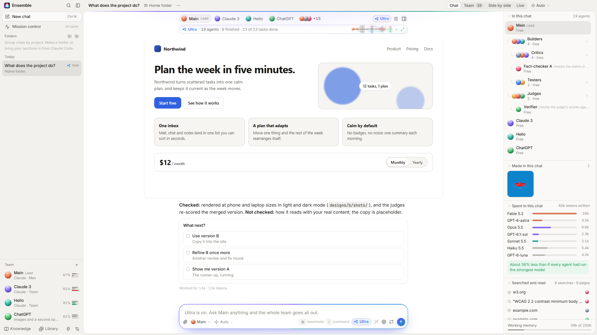</picture></td>
<td width="50%"></td>
</tr>
<tr>
<td><b>An answer you can check.</b> The lead tells you which version won and why, what was merged, what was checked by running or looking at it, and what was not. <i>(Demo team.)</i></td>
<td><b>Mission control.</b> Every chat the team is working in at once: who is busy, what each agent is doing, how far each plan is, and how every account's session, weekly and top-model allowance stands.</td>
</tr>
<tr>
<td></td>
<td></td>
</tr>
<tr>
<td><b>See and hear what it makes.</b> Images, audio and video appear in the chat as they are made. When an agent asks you to choose between voices or designs, each option plays inside the question.</td>
<td><b>Connectors.</b> GitHub, Supabase, Stripe, search, ElevenLabs, a folder, or any MCP server, set up once for every account. The ones you already have in Claude Code and Codex come in by themselves.</td>
</tr>
</table>

It also has memory in your Obsidian vault, a browser for every agent, computer control with your OK, undo for any reply's file changes, and approvals as cards that show the exact command. [More below](#everything-else).

## How it works

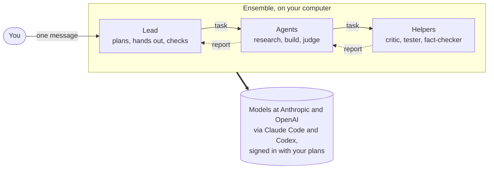

Ensemble never talks to a model itself and never reads a sign-in token. Every agent is the provider's own: Claude accounts run the [Claude Agent SDK](https://code.claude.com/docs/en/agent-sdk/overview) on the Claude Code installed on your computer, and ChatGPT accounts run the [Codex SDK](https://www.npmjs.com/package/@openai/codex-sdk). A hub in the app gives every agent the team's tools (hand out a task, start an agent, message or ask anyone, pin a decision to a shared board, rate a model's work), routes tasks and reports between them, and picks the account and the model for each piece of work.

## Get started

1. **[Download the installer](https://github.com/Kerim-Sabic/ensemble/releases/latest)** and run it. The installer isn't signed yet, so Windows may warn you: choose *More info*, then *Run anyway*.
2. **Sign in** with Claude or ChatGPT in your browser, with the plan you already have. No API keys. Accounts already signed in on your computer are found for you, and if Claude Code is missing, Ensemble installs it from Anthropic.
3. **Ask for something real**, then open the **Team** tab and watch. For a result that matters more than your allowance, press **Alt+U** first.

**Needs:** Windows 10 or 11 (64-bit) and a Claude Pro or Max plan, a ChatGPT plan, or both. [Git for Windows](https://git-scm.com/downloads/win) helps Claude run commands. Ensemble updates itself.

### On a Mac (new, lightly tested)

Ensemble runs on macOS too, on Apple silicon and Intel. It has been built and checked by the team, not yet used for long on real Macs, so please [say what breaks](https://github.com/Kerim-Sabic/ensemble/issues).

1. From the [latest release](https://github.com/Kerim-Sabic/ensemble/releases/latest), download `Ensemble-<version>-arm64.dmg` for Apple silicon (M1 and later) or `Ensemble-<version>-x64.dmg` for an Intel Mac. Open it and drag Ensemble into Applications.
2. The app is not signed with an Apple Developer ID yet, so the first time you open it macOS says it cannot check it. Open **System Settings → Privacy & Security**, find the line about Ensemble and choose **Open Anyway**. You only do this once.
3. Sign in and ask, as above. The shortcut is <kbd>Option</kbd>+<kbd>Shift</kbd>+<kbd>Space</kbd> and Ultra is <kbd>Option</kbd>+<kbd>U</kbd>.

What is different on a Mac: **computer control is Windows only** (the browser for every agent works), and **the Mac app does not update itself yet**: download new versions from the releases page. Both change once the Mac build is signed.

## Ways to work

<table>
<tr>
<td width="50%"><picture><source media="(prefers-color-scheme: dark)" srcset="docs/screenshots/goal-dark.png" /></picture></td>
<td width="50%"><picture><source media="(prefers-color-scheme: dark)" srcset="docs/screenshots/loop-dark.png" /></picture></td>
</tr>
<tr>
<td><b>Goals.</b> Say what done looks like and the team keeps going until it is. After every reply, a fresh checker that did none of the work reads the record of what was run and sends the lead back with what is missing. <code>/goal all tests pass and the build is green</code></td>
<td><b>Loops.</b> A message that sends itself again, every ten minutes, every morning or at the agent's own pace, until its stop condition is true, then tells you. <code>/loop 10m check whether the deploy is live</code></td>
</tr>
<tr>
<td>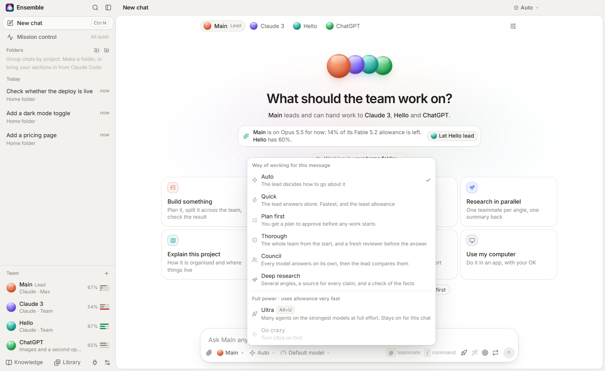</td>
<td><picture><source media="(prefers-color-scheme: dark)" srcset="docs/screenshots/plan-first-dark.png" /></picture></td>
</tr>
<tr>
<td><b>Ways of working, per message.</b> <i>Quick</i>: the lead answers alone. <i>Thorough</i>: the whole team plus a fresh reviewer. <i>Council</i>: every model answers on its own and the lead compares them. <i>Deep research</i>: several angles, a source for every claim, a check of the facts.</td>
<td><b>Plan first.</b> You see the plan and who does what, and nothing starts until you say go. Plain words work too: "don't stop until every test passes" sets the goal by itself.</td>
</tr>
</table>

**Steer while it works.** You don't have to wait for a reply to change course. A message you send while an agent is working reaches that work at its next step, and the agent carries on with it in mind. To wait for the reply instead, press <kbd>Alt</kbd>+<kbd>Enter</kbd>.

### Ultra, Go crazy and deep teams

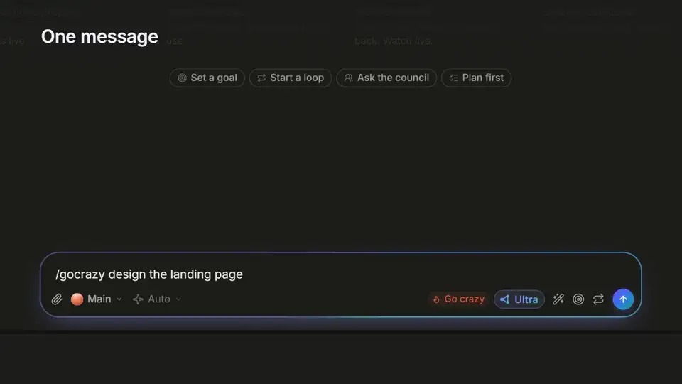

<sub>One <code>/gocrazy</code> request with the demo team, a 14-second loop, sped up. The same loop as video: <code>docs/media/ensemble-loop.mp4</code>.</sub>

- **Ultra** (Alt+U, or `/ultra on`) is for when the result matters more than the allowance. The lead writes a rubric first. Scouts on the fastest models research on the web, each on one angle. The strongest models each build their own complete version, without seeing the others. Judges who did none of the work score every version, the best one takes the best ideas of the rest, and it is refined and checked by running it or looking at it. Up to 20 extra agents. A thank-you or a small follow-up is still answered directly.
- **Go crazy** (`/gocrazy`, in Ultra only) is Ultra at full scale, organised like a brain. The lead starts regions for research, building, judging and memory, and each region has a lead of its own with a team under it. More builders, a round where the versions critique each other, and two rounds of judging. There is no fixed number of agents. Before each new agent, Ensemble checks how much this computer can carry (free memory and processor cores) and which accounts still have allowance. A goal set in Go crazy keeps Go crazy for every round.
- **Deep teams.** Agents start agents. In Ultra each builder gets its own critic on a different model and a tester that runs or renders its draft, and a critic can start a fact-checker. A task stays open until its helpers have reported. Teams go two levels deep in an ordinary chat, three in Ultra and up to eight in Go crazy.

<picture>
  <source media="(prefers-color-scheme: dark)" srcset="docs/screenshots/network-done-dark.png" />
  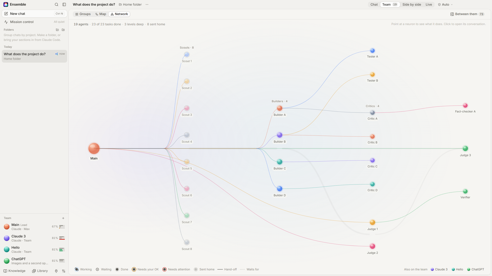
</picture>

### The brain view

When a chat runs Go crazy with a goal, the chat shows it as a brain. The lead sits in the centre, ringed by the goal's rounds, and the regions cluster around it: research, building, judging and memory, each with its own team. Pulses travel along the handoffs while agents work. Above the view you see the goal, the round, and what the last check said is still missing. When the goal is met, the view says so and points you to the lead's answer.

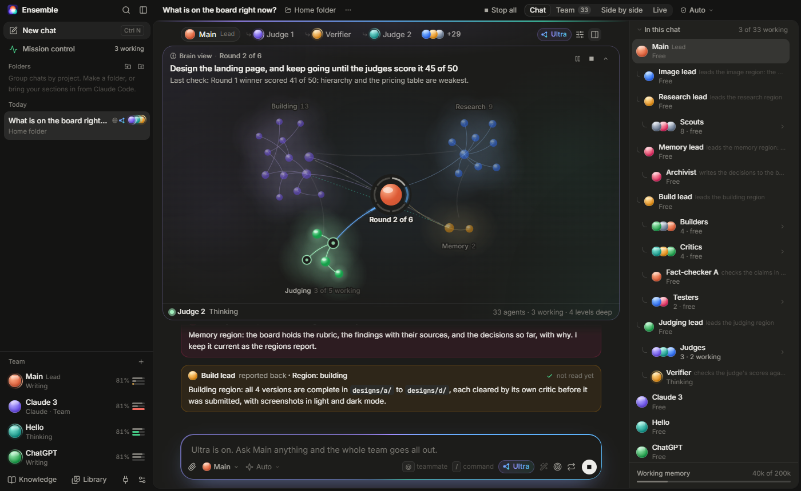

<sub>The demo team's own Go crazy run with a goal: 33 agents, four levels deep.</sub>

<table>
<tr>
<td width="50%"><picture><source media="(prefers-color-scheme: dark)" srcset="docs/screenshots/brain-48-dark.png" />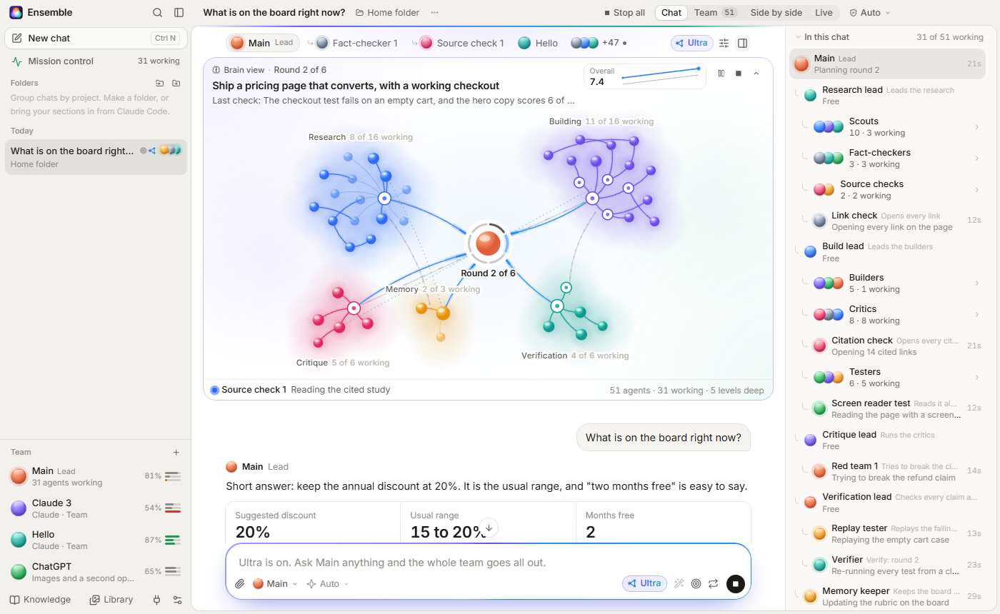</picture></td>
<td width="50%"><picture><source media="(prefers-color-scheme: dark)" srcset="docs/screenshots/brain-met-dark.png" />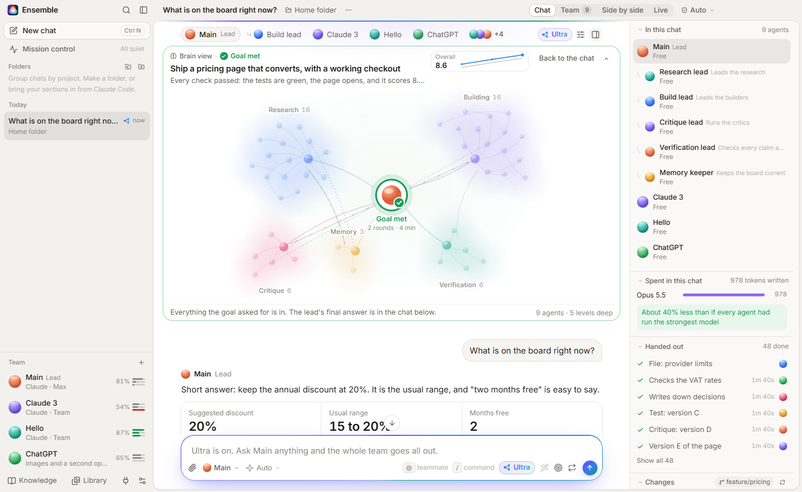</picture></td>
</tr>
<tr>
<td><b>At scale.</b> Fifty agents stay readable: each region is labelled with how many of its agents are working.</td>
<td><b>Goal met.</b> The regions settle, and the view tells you where to find the answer.</td>
</tr>
</table>

<sub>These two pictures were filled with made-up agents and tasks to show the view at a larger scale.</sub>

## Live answers

Answers you can use, not only read. When seeing or doing beats reading, an agent puts a chart, a table, a comparison, a plan with progress, a diagram, a form or a calculator right into its reply, drawn by the app in its own look, light and dark. Pick an option or submit a form, and your answer goes back to that agent as your next message.

For anything else (a small game, a simulation, a one-off tool) an agent writes a **mini app**. It runs in a locked box with no network, no files and no access to the app or your computer. It can offer you a message to send, but never sends one itself. Live answers work with every model on your team.

<picture>
  <source media="(prefers-color-scheme: dark)" srcset="docs/screenshots/live-answers-landing-dark.png" />
  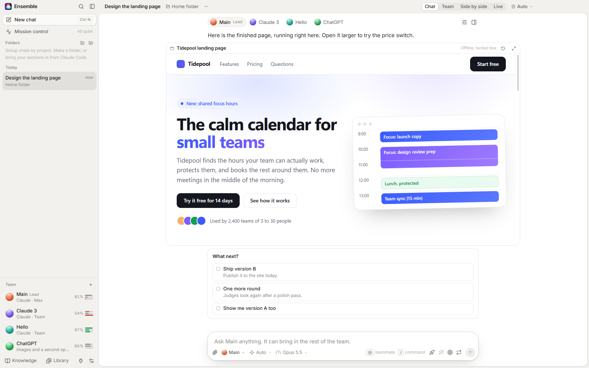
</picture>

<table>
<tr>
<td width="50%"><picture><source media="(prefers-color-scheme: dark)" srcset="docs/screenshots/live-answers-chart-dark.png" /></picture></td>
<td width="50%"><picture><source media="(prefers-color-scheme: dark)" srcset="docs/screenshots/live-answers-calc-dark.png" /></picture></td>
</tr>
<tr>
<td><b>Charts and tables</b> from real data, with the takeaway in words.</td>
<td><b>Calculators</b> that recompute as you change the inputs.</td>
</tr>
</table>

<sub>Pictures from the demo team and the app's own gallery of examples. The page, its product and the numbers in them are made up for the demonstration.</sub>

## Claude, ChatGPT or both

Any mix is a full team: one account or six, all Claude, all ChatGPT, or both. Every account plans, builds, researches and reviews, and ChatGPT accounts also draw images. On a team of ChatGPT accounts alone nothing is missing: the lead, the goal checker, chat titles and the message improver all run on ChatGPT. A ChatGPT lead starts its Ultra and Go crazy teams through Ensemble, so every agent shows in the network and works with the rest of the team. Ultra adapts to whatever models the team has.

**Design work with real images.** When the team has a ChatGPT account, design requests get an image agent of their own. It makes a moodboard of clearly different directions first, then the pictures and assets the builders need. The builders put them in place, and the judges see the screens with the real images.

## What it costs

Ensemble is free and open source, with no Ensemble account and nothing to buy. It runs on the Claude and ChatGPT plans you already have, so there is nothing extra to pay and no API bill. It never shares, sells or pools accounts: everyone signs in with their own. It is careful with those plans: the lead gets the strongest model the allowance allows and the rest run a step below, every task's model is rated afterwards so cheaper models are trusted with the work they do well, and work moves to an account with allowance left rather than failing. Ultra is the exception: it spends fast, on purpose.

## When an account runs out

You don't have to watch your limits. Ensemble keeps an eye on every account's session and weekly allowance, and the team panel shows each one as fine, **running low**, or **out until 19:32**.

- **The lead runs out.** The teammate best placed takes over as lead by itself: the one with the most allowance left and the strongest model, from the same provider where possible. It is caught up on the chat and carries on with what was under way, including a goal. The chat shows one line: *"Hello took over as lead: Main ran out of usage. Main is back at 19:32."* When Main has allowance again, that line offers **Hand back to Main**. It never switches back on its own, because by then the new lead knows the chat.
- **The lead is about to run out.** It hands over at the end of its reply, never in the middle of one.
- **A teammate or an agent runs out.** Its task moves to someone with room. An agent the team started moves to another account and takes a summary of its work with it.
- **Everyone is out.** The work waits, you are told once when it goes on by itself, and the first account to refill picks it up.

Turn it off in Settings (*Hand over when an account runs out*) and you are offered the switch instead.

## Watches and the Inbox

Ensemble can keep an eye on things for you while you do something else: a schedule ("every weekday at 8"), failed CI runs, new issues or pull requests, a web page, a folder. Make one by asking in plain words, from the Inbox, or with `/watch`.

<picture>
  <source media="(prefers-color-scheme: dark)" srcset="docs/screenshots/inbox-dark.png" />
  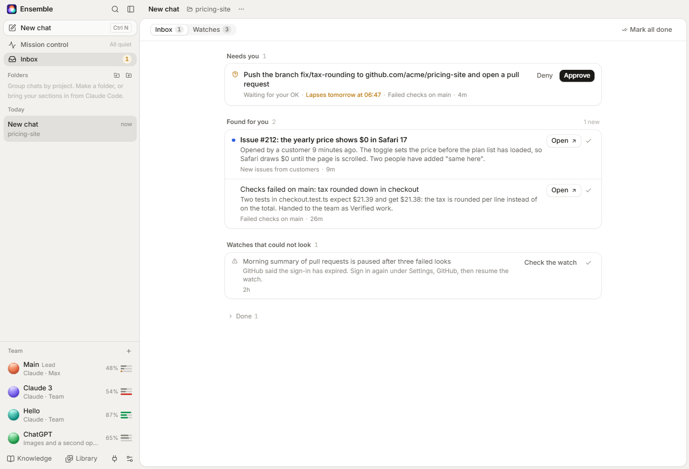
</picture>

<sub>The demo team, with made-up projects and issues.</sub>

- **Silent unless something changed.** A look compares what it sees with the last time, without a model. Only a change is read, once, by the cheapest model, and most looks end in nothing and say nothing.
- **One place for what needs you.** The Inbox shows what waits for you first (an approval, a blocked goal), then what the watches found. Each item says where it came from.
- **Limits, so it never eats the allowance you need.** By default at most 60 looks a day, 30 per account, none on an account with less than 30% left, and a watch may start a team chat at most three times a day. You can change them from the Watches list.

<picture>
  <source media="(prefers-color-scheme: dark)" srcset="docs/screenshots/watches-dark.png" />
  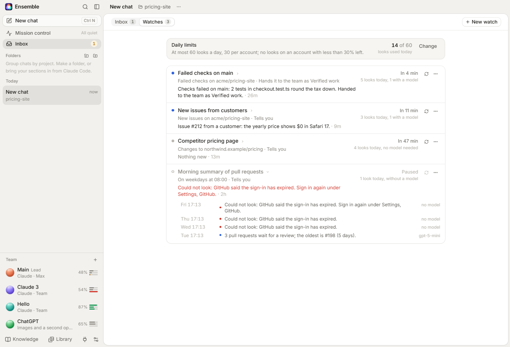
</picture>

### Work nobody is watching

A run started by a watch is held to rules the app enforces itself, not rules written in a prompt. The details are in [docs/SECURITY.md](docs/SECURITY.md); in short:

- It may read and change files inside its own folder.
- It reaches the web only on sites you approve, and each approval lasts for that run.
- Anything else that goes out or cannot be undone (a push, a post, a message, a delete outside the folder) waits for your approval. The approval covers exactly that one action and lapses after 12 hours.
- It cannot control your computer, and it gets no shell commands where there is no sandbox for them.
- Every decision goes into a record that shows if it was altered afterwards.

## Your phone, from anywhere

Turn on **Phone and remote** in Settings and scan the code with your phone's camera. From any phone browser you can follow chats live, message or steer the lead, stop the team, and approve or deny. It is off until you turn it on.

- **On the same Wi-Fi,** or **from anywhere over a private network such as Tailscale.**
- **From anywhere through a relay on your own Cloudflare account** (free plan). Everything between your phone and your computer is encrypted end to end and the relay cannot read or change it. It does serve the phone's page, which is why it must be your own and why there is no shared one. Steps: [relay/README.md](relay/README.md).
- **The phone's Inbox:** what needs you first, then what watches found, with approve and deny, Stop for any chat, and notifications that say only that something needs you, never what a chat is about.

A paired phone cannot touch accounts, settings, permission levels or computer control. **Honest status:** the phone page has not been tried on a real iPhone yet, only in a desktop browser at phone size, and the Cloudflare version of the relay has only been run through a stand-in on a computer, not yet deployed.

## What I learned

Everything the team keeps between chats says where it came from, so you can check it and take it back.

<picture>
  <source media="(prefers-color-scheme: dark)" srcset="docs/screenshots/what-i-learned-dark.png" />
  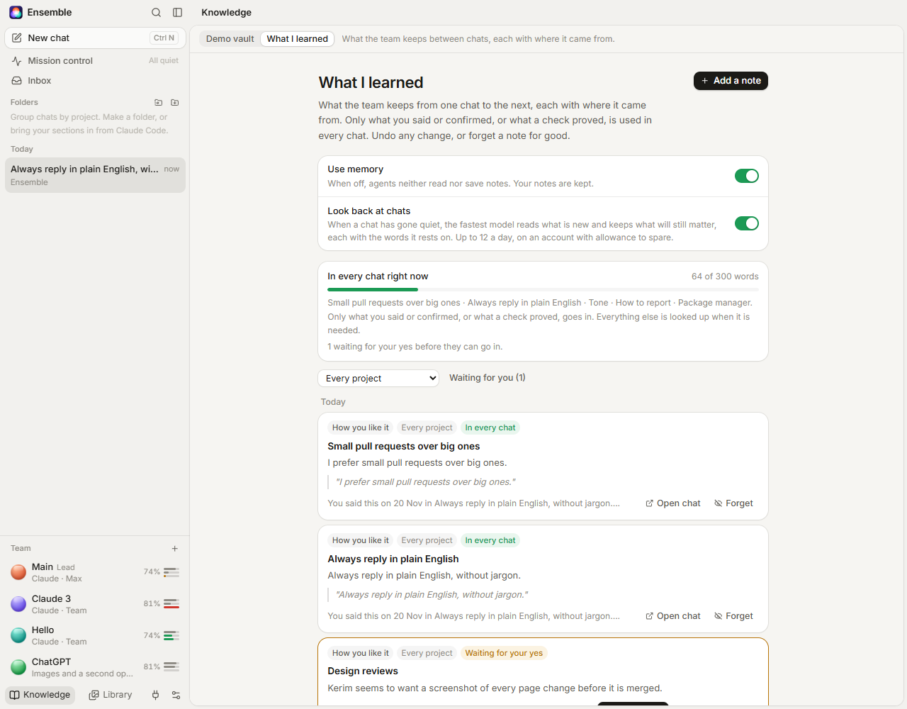
</picture>

- **A source for every note:** your own words, a check that passed, or an agent's guess, which waits for your yes before it is used.
- **Undo and Forget.** Undo any change; Forget removes a note everywhere.
- **A small memory for each chat.** Each chat starts with at most 300 words chosen for it. Everything else, including the real messages of earlier chats, is searched when needed.
- **A look back after a chat goes quiet.** The fastest model keeps only what a quote in the chat backs, up to 12 times a day, with a switch in Settings.

## Faster, lighter, and goals that finish

- **Long chats stay smooth.** Only what is on screen is drawn, and typing and scrolling no longer stall while a big team works. Agents that are idle close their programs after four minutes and reopen on their next turn.
- **A goal is checked when the whole team's work is in,** and waiting for the team no longer uses up rounds. A task nobody is working on is closed and reported after two minutes, and changing the lead no longer pauses a goal.

## Where your data goes

- **Ensemble itself has no server and collects nothing.** There is no Ensemble account and no analytics.
- **It runs on your computer with your own sign-ins.** Your chats, memory and settings are stored there, in `%APPDATA%\Ensemble`, and your notes in the vault you choose. Connector keys are encrypted with your Windows account (on a Mac, with the Keychain). On a Mac the folder is `~/Library/Application Support/Ensemble`.
- **The models run at Anthropic and OpenAI.** Your messages, and the files and pages your agents read, are sent to them as they are when you use their own apps, under your plan's terms.
- **Watches, the Inbox and what the team learned** are stored on your computer too. A look at a web page, GitHub or a folder fetches only what you asked it to watch.
- **The phone relay,** if you set one up, runs on your own Cloudflare account and sees only encrypted traffic and when devices connect ([relay/README.md](relay/README.md)).
- **Updates** come from this repository's releases.

### Check a download

Releases that list a `SHA256SUMS.txt` among their files can be checked before you run them:

- **Checksum.** Compare the file's SHA-256 with its line in `SHA256SUMS.txt`. Windows (PowerShell): `Get-FileHash .\Ensemble-Setup-<version>.exe`. macOS: `shasum -a 256 Ensemble-<version>-arm64.dmg`.
- **Where it was built.** Each file carries a build-provenance attestation from GitHub that says which workflow run, in this repository, made it. With the [GitHub CLI](https://cli.github.com): `gh attestation verify Ensemble-Setup-<version>.exe --repo Kerim-Sabic/ensemble`.
- **What is inside.** `ensemble-<version>.spdx.json` lists every package the release was built from.

How releases are signed, and what an installed copy checks before it updates: [docs/RELEASING.md](docs/RELEASING.md).

## Honest limits

- **Windows first.** Windows 10 or 11, 64-bit. macOS is new and lightly tested; on a Mac there is no computer control and no self-update yet.
- **Plans have terms.** Ensemble uses each provider's own agent with your own sign-in, but how many accounts you may run, and how, is between you and each provider.
- **Ultra uses allowance fast.** It is built to spend more for a better result. Leave it off for everyday work.
- **Go crazy uses your computer too.** Every agent is a process on your computer, and Go crazy starts as many as your free memory, processor and allowance allow. Close heavy programs before a big run.
- **Watches use allowance.** Looks are cheap and capped, and an unattended run keeps to the rules above, but a watch that hands work to the team uses the same plans as anything else.
- **Agents act in your folders.** You choose per chat how much they may do: ask first, edit freely, auto or full access.
- **The installers aren't signed yet,** so Windows warns about an unknown publisher and macOS asks you to allow the app once. The release workflow is ready to sign them ([docs/RELEASING.md](docs/RELEASING.md)).

## FAQ

<details>
<summary><b>Do I need an API key?</b></summary>

No. You sign in with your Claude or ChatGPT plan, the same way you would in Claude Code or Codex.
</details>

<details>
<summary><b>Can I try it without signing in to anything?</b></summary>

Yes. On the first screen, choose **Try the demo team**: the app restarts with a scripted demo team, uses no account and no allowance, sends nothing anywhere, and says so in a bar at the top. **Sign in and use it for real** brings you back. It is also in the command palette and in Settings. The pictures marked "demo team" above were made with it.
</details>

<details>
<summary><b>Does it work with only ChatGPT, or only Claude?</b></summary>

Yes, either one alone is a full team. See [Claude, ChatGPT or both](#claude-chatgpt-or-both).
</details>

<details>
<summary><b>How is this different from sub-agents inside Claude Code or Codex?</b></summary>

Those stay inside one account and one product. Ensemble puts several accounts and both providers on one team, lets every agent message any other, shows the whole team live, and adds what a team needs around the work: goals with a fresh checker, loops, judging by agents who did none of the work, and memory across chats.
</details>

<details>
<summary><b>Will it burn through my plan?</b></summary>

Ordinary chats use cheaper models below the lead and show what each model wrote. Ultra and Go crazy are the exception: they are meant to use a lot, and say so.
</details>

<details>
<summary><b>Is a mini app safe to run?</b></summary>

It runs in a sandboxed frame with scripts only, under a content policy that allows nothing from outside: no network, no files, no popups, no access to the app or your computer. Found a way out? Please report it privately ([security policy](docs/SECURITY.md)).
</details>

## Roadmap

Ideas, not promises. Tell us what you want most in [Issues](https://github.com/Kerim-Sabic/ensemble/issues).

- Signed installers for Windows and macOS, so neither warns, and self-update on the Mac.
- Live answers that keep their state after a restart.
- Labels for each stage (scouts, builders, judges) in the ordinary network view, as the brain view already has for its regions.

## Everything else

- **Memory.** Your Obsidian vault is searched before every request and every task, and each substantial chat leaves a note behind, so the next one starts from it. No Obsidian? Ensemble makes a vault for you.
- **Folder instructions.** File chats in folders and give a folder instructions, like a project's.
- **Bring your history.** Import your Claude Code conversations, with their sidebar sections as folders.
- **A browser for every agent**, shown live with every step recorded. When a site needs your sign-in, the agent asks and waits.
- **Computer control, with your OK**, for things that only exist in an app's window. Esc stops it.
- **Small things:** undo any reply's file changes · "Have it checked" by a fresh agent · approvals as cards with the exact command · tray and global shortcut (Alt+Shift+Space) · notifications · light and dark · updates itself.

## Contributing

Bug reports, ideas and pull requests are welcome: see [CONTRIBUTING.md](CONTRIBUTING.md). Security problems: please report them privately, as the [security policy](docs/SECURITY.md) describes. What changed in each version: [CHANGELOG.md](CHANGELOG.md).

### Build from source

```bash
git clone https://github.com/Kerim-Sabic/ensemble.git
cd ensemble
pnpm install
pnpm dev        # run with hot reload
pnpm dist       # build the installer into dist/
```

Set `ENSEMBLE_DEMO=1` to run the whole app with its scripted demo team, without touching any account. `pnpm auto-test` checks the engine against that team.

## License

[MIT](LICENSE)
