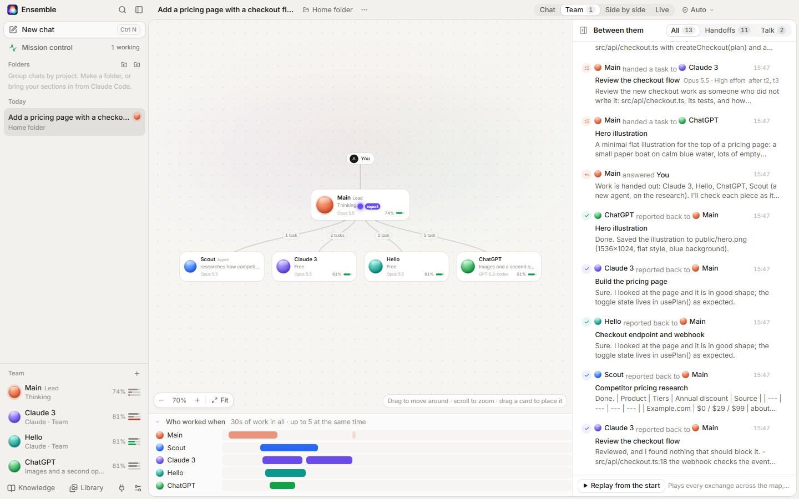
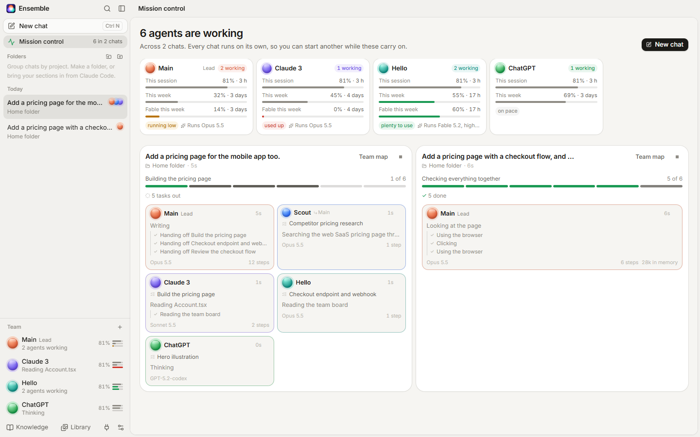
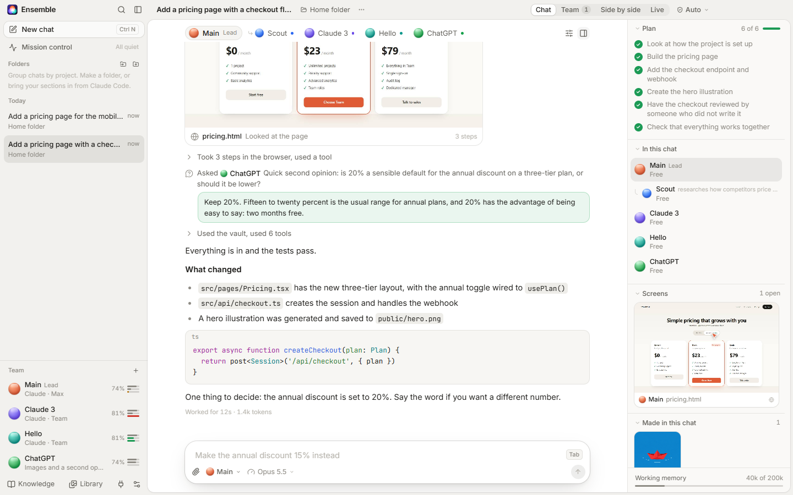
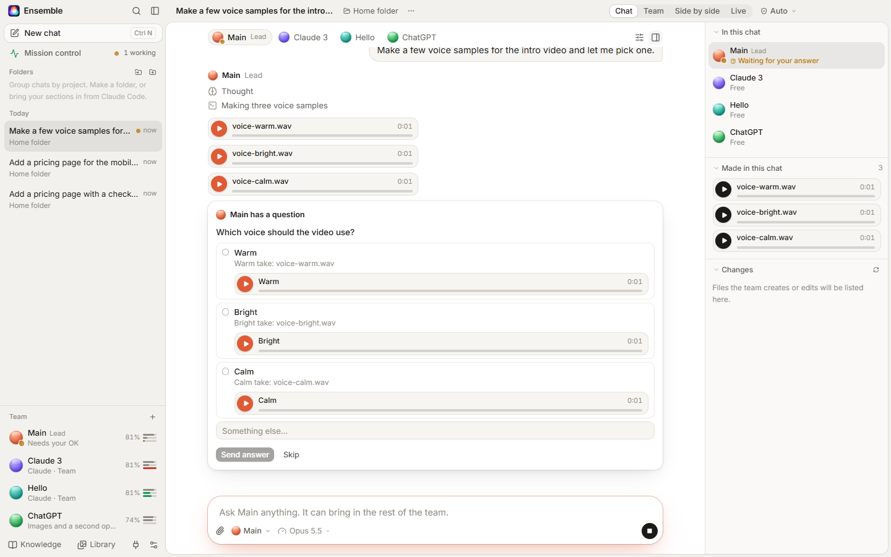
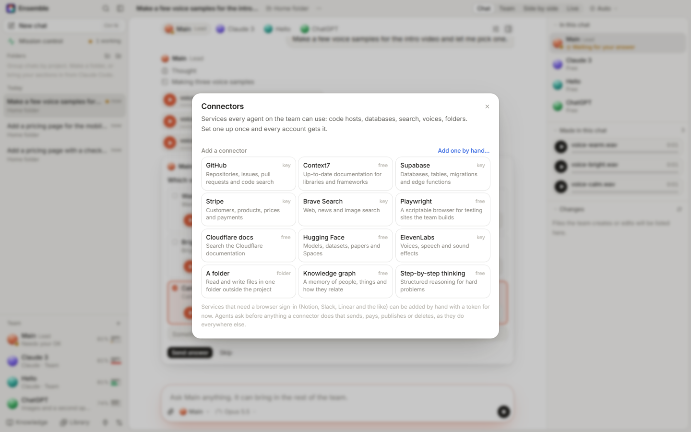
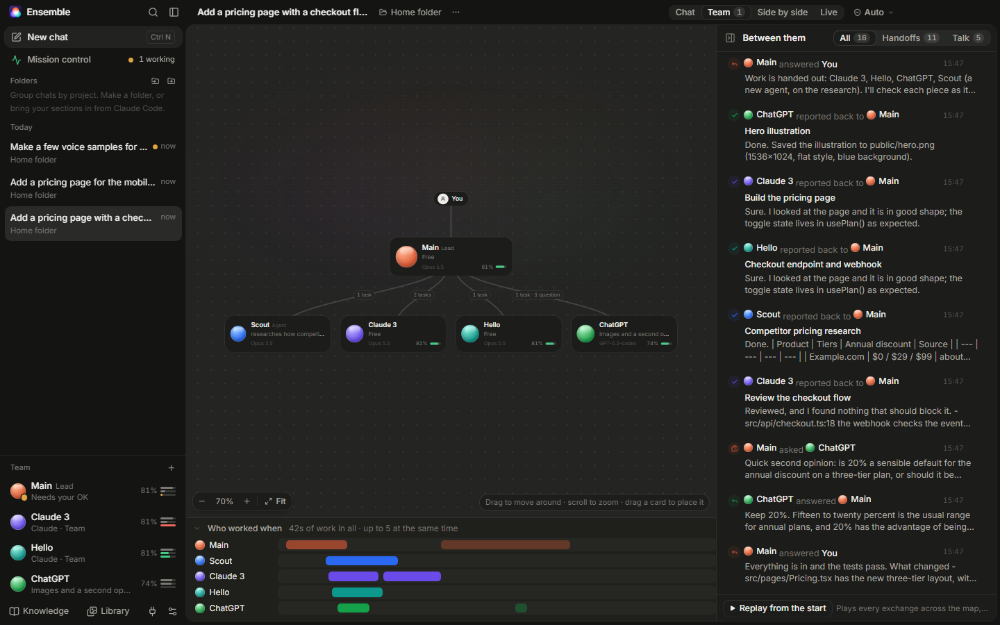
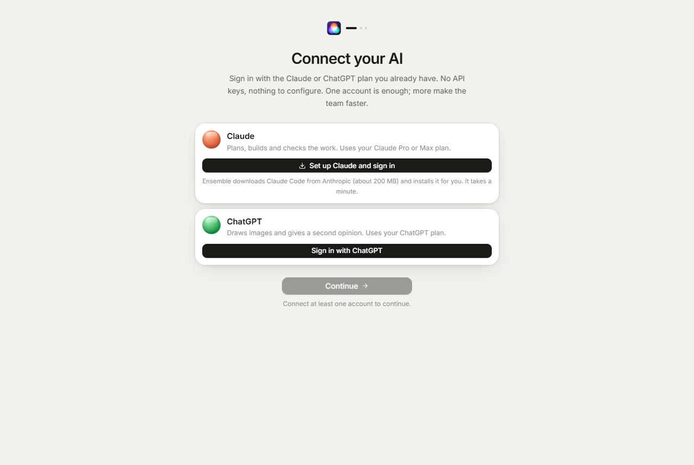

<div align="center">


# Ensemble

### Every AI account you have, working as one team.

Ensemble turns your Claude and ChatGPT accounts into a team of agents: a lead that plans, teammates that build in parallel, sub-agents that take the small jobs, and a map that shows you all of it live. It spends each account's allowance where it counts, remembers what the team learned, and gets cheaper the more you use it.

**[Download for Windows](https://github.com/Kerim-Sabic/ensemble/releases/latest)** · [What it does](#what-it-does) · [How it works](#how-it-works) · [Build from source](#build-from-source)



</div>

---

## Why

One chat with one model is one pair of hands. Real work splits: research from three angles, a frontend and a backend at the same time, a reviewer who did not write the code. Ensemble gives you that team out of the accounts you already pay for, and lets you watch it work.

- **Got one account?** The lead starts helper agents on it whenever the work splits. You get a team anyway.
- **Got several?** Each one works on its own allowance, side by side. When one runs dry, its work moves to another.
- **Watching your usage?** The strongest model plans and checks; everyone below it runs something cheaper, and Ensemble learns which cheaper models are good enough for which kind of work.

## What it does

<table>
<tr>
<td width="50%"></td>
<td width="50%"></td>
</tr>
<tr>
<td><b>Mission control.</b> Every chat the team is working in, at once: who is busy, what each agent is doing and just did, how far each plan is, and how every account's session, weekly and top-model allowance stands.</td>
<td><b>A lead that plans and checks.</b> It splits the work, hands parts out with real briefs, lines up reviews behind builds, runs the tests itself, and tells you only what it verified.</td>
</tr>
<tr>
<td></td>
<td></td>
</tr>
<tr>
<td><b>See and hear what it makes.</b> Images, audio and video appear in the chat as they are made. When an agent asks you to choose between voices or designs, each option plays right inside the question.</td>
<td><b>Connectors.</b> GitHub, Supabase, Stripe, search, ElevenLabs, a folder, or any MCP server, set up once for every account. Ensemble brings in the ones you already have in Claude Code and Codex.</td>
</tr>
</table>

### The team

- **Agents that start agents.** The lead starts extra agents in a chat (a researcher per angle, a tester, an owner for each part of a build), and those start sub-agents for parts of their own work. A task stays open until its sub-agents have reported.
- **Everyone talks to everyone.** Any agent can message or ask any other, across accounts, mid-task. A shared board holds what they all have to keep to: an interface, a name, who owns which files.
- **A map you can move around.** Drag to pan, scroll to zoom, drag cards to arrange them. A new agent joining out of sight brings the view to it. Replay a whole chat's exchanges from the start.
- **Claude and ChatGPT together.** Claude accounts build; a ChatGPT teammate draws images and gives a second opinion.

### Spending allowance wisely

- **A cascade of models.** The lead gets the strongest model the allowance allows. Teammates run a step below, sub-agents cheaper still. Three modes: Save most, Ensemble decides, Best quality.
- **It learns.** After each task, whoever handed it out rates the model: enough, too weak, more than needed. Ratings are kept per kind of work (research, code, review, writing, media, routine), so a cheap model can be trusted with routine jobs without being given code.
- **It recovers.** A task a cheap model fails is tried once more a step up. A task nobody has allowance for waits and starts by itself when the first account refills. If the top model hits its own limit mid-task, the same work carries on one model down.
- **It shows the bill.** Each chat lists what every model wrote, and roughly how much less that was than running everything on the strongest model.

### Memory

- **Your Obsidian vault as long-term memory.** Before the lead starts on a request, and before any task, the vault is searched and the notes that matter are put in front of the agent. Every substantial chat leaves a note behind (what was asked, where it ended, who did what, which files changed), so the next chat starts from it. No Obsidian? Ensemble makes a vault for you.
- **Folder instructions.** File chats in folders, give a folder instructions like a project's, and every agent in every chat there follows them.
- **Bring your history.** Import your Claude Code conversations with their sidebar sections as folders. The lead carries on in a copy of each conversation and remembers all of it.

### Hands

- **A browser for every agent.** Real pages, clicked and read, shown to you live with every step recorded. When a site needs your sign-in, the agent asks and waits; one click puts the mouse in your hand. Sign-ins are kept for the whole team.
- **Computer control, with your OK.** For things that only exist in an app's window. A notice stays on screen while an agent is in control, and Esc stops it.

### Everything else

Undo any reply's file changes · "Have it checked" by a fresh agent · approvals as cards with the exact command · tray, global shortcut (Alt+Shift+Space), notifications · light and dark · updates itself.



## Get started

1. **Download** the installer from the [latest release](https://github.com/Kerim-Sabic/ensemble/releases/latest) and run it. Windows may warn that the app is from an unknown publisher: choose *More info*, then *Run anyway*.
2. **Connect your AI.** Click *Sign in with Claude* or *Sign in with ChatGPT* and sign in in your browser, with the plan you already pay for. No API keys. Don't have Claude Code? Ensemble downloads and installs it for you from Anthropic. Accounts already signed in on your computer are found and ticked for you.
3. **Give your team a memory.** Pick one of your Obsidian vaults, or let Ensemble make one in Documents. You don't need Obsidian installed for this to work.
4. **Ask for something real.** "Research the three best options for X and compare them", "Build a pricing page with a checkout flow", "Find out why the tests fail and fix it". Then open the Team tab and watch.



Ensemble updates itself: new versions download in the background and install the next time you close it.

**Requirements:** Windows 10 or 11 (64-bit), and a Claude Pro or Max plan or a ChatGPT plan. Claude runs commands best with [Git for Windows](https://git-scm.com/downloads/win) installed. Some connectors need [Node.js](https://nodejs.org) or [uv](https://docs.astral.sh/uv/).

## How it works

Ensemble never talks to a model itself and never reads a sign-in token. Each teammate is the provider's own agent, started with that account's own folder:

- **Claude accounts** run through the [Claude Agent SDK](https://docs.claude.com/en/api/agent-sdk/overview) on the Claude Code installed on your computer.
- **ChatGPT accounts** run through the [Codex SDK](https://www.npmjs.com/package/@openai/codex-sdk).

A hub in the app's main process gives every agent the team's tools (`roster`, `assign_task`, `spawn_agent`, `message`, `ask`, `board_post`, `rate_work`, the vault, the browser and more), routes tasks and reports between them, and picks the model and the account for each piece of work.

```
src/
  main/        the engine: hub, sessions, providers, browser and computer, vault, connectors, learning
  preload/     the bridge to the window
  renderer/    the interface (React, Tailwind)
  shared/      types, the model budget, the connector catalog
```

Your data stays on your computer, in `%APPDATA%\Ensemble`. Connector keys are encrypted with your Windows account.

## Build from source

```bash
git clone https://github.com/Kerim-Sabic/ensemble.git
cd ensemble
pnpm install
pnpm dev        # run with hot reload
pnpm dist       # build the installer into dist/
```

`ENSEMBLE_DEMO=1 pnpm dev` runs the whole app with scripted stand-in agents, without touching any account.

### Releasing

Bump `version` in `package.json`, commit, and push a tag:

```bash
git tag v3.4.1 && git push origin v3.4.1
```

GitHub Actions builds the installer and publishes the release. Every installed copy picks it up on its own.

## Good to know

- **Plans have terms.** Ensemble uses each provider's official sign-in and official agent, but how many accounts one person may run is between you and each provider.
- **Agents act in your folders.** Choose how much they may do per chat: ask first, edit freely, auto, or full access. Keep computer control on "Ask first" unless you are watching.
- **Pages can lie.** Agents treat what they read on a page, a screen or a connector as information, not instructions, and stop to ask before anything that spends money, sends or posts in your name, or deletes something.

## License

[MIT](LICENSE)
