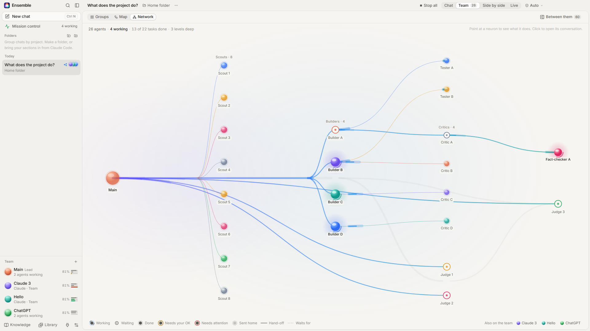
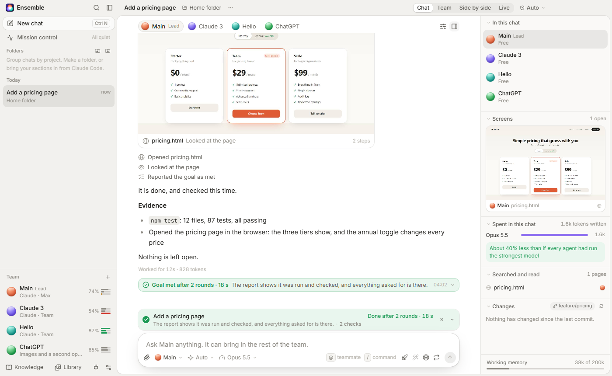
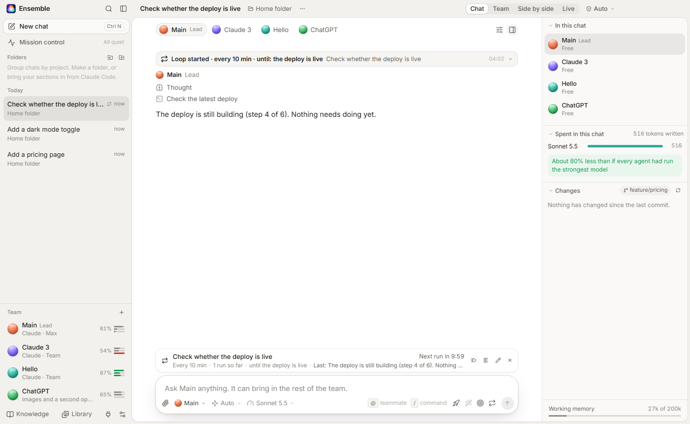
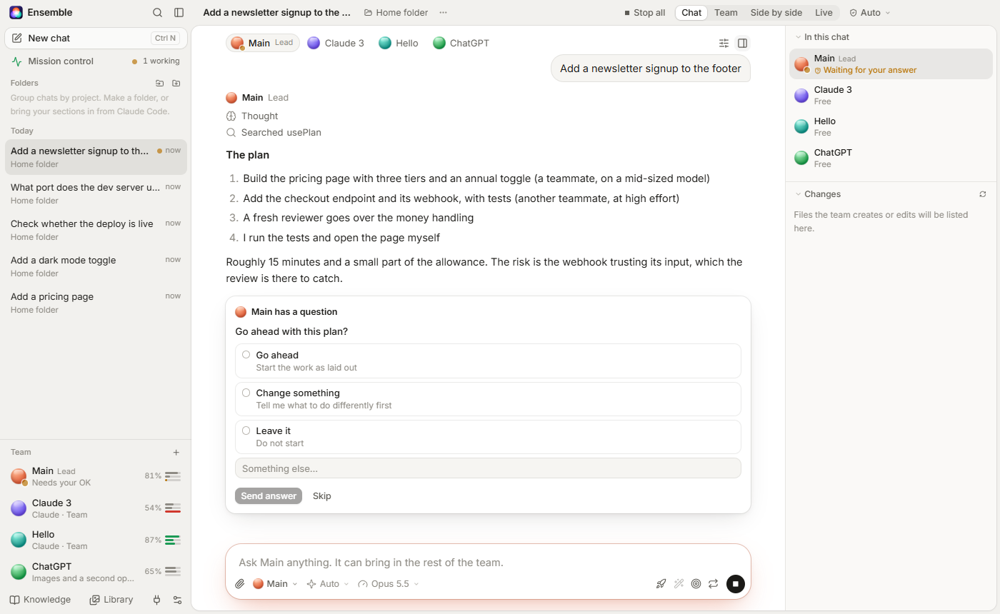
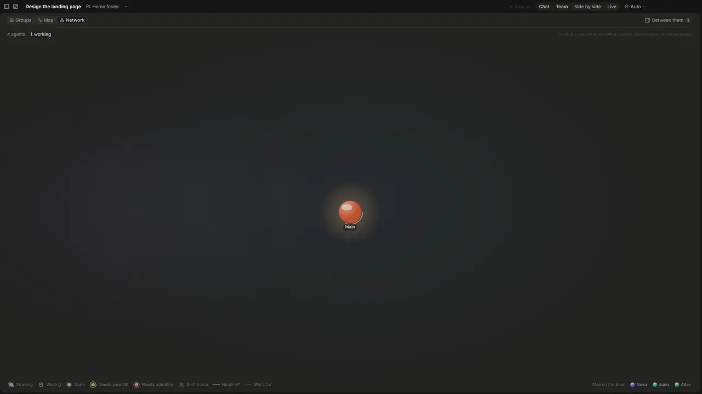
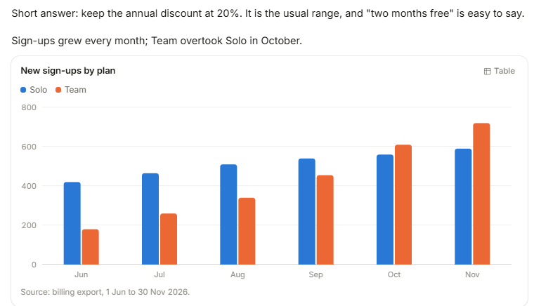
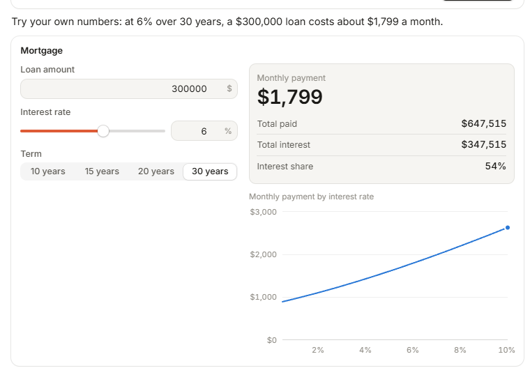

<div align="center">


# Ensemble

### One message becomes a team of AI agents, and you watch it work.

A free, open-source Windows app that turns the Claude and ChatGPT accounts you already have into one team: a lead that plans, agents that start agents of their own, and a live network of all of it.

### [⬇ Download for Windows](https://github.com/Kerim-Sabic/ensemble/releases/latest)

Free · open source · no Ensemble account

[](https://github.com/Kerim-Sabic/ensemble/releases/latest) [](https://github.com/Kerim-Sabic/ensemble/releases/latest) [](LICENSE)

<!-- FILM GOES HERE: the short silent launch loop (MP4, H.264, under 10 MB). On github.com, edit this file,
     drag the MP4 into the editor, copy the https://github.com/user-attachments/assets/... link it writes, and put
     it here as:  <video src="LINK" width="100%" controls muted loop playsinline></video>
     GitHub READMEs are not known to autoplay video, so keep the still network picture below as well.
     Then delete this comment. -->

<picture>
  <source media="(prefers-color-scheme: dark)" srcset="docs/screenshots/network-active-dark.png" />
  
</picture>

<sub>One <code>/gocrazy</code> request, shown with Ensemble's demo team (scripted stand-in agents that ship with the app).</sub>

</div>

- **A team, not a chat.** A lead splits the work, hands it out with real briefs, and checks what comes back. Agents start helpers of their own, and judges who did none of the work score the results.
- **The plans you already pay for.** Sign in with Claude, ChatGPT or both, one account or several. Ensemble is free, and every account works side by side.
- **You see all of it.** Every agent is a node and every handoff a line, drawn live as the team forms, works and finishes.

---

**Contents:** [What it does](#what-it-does) · [How it works](#how-it-works) · [Get started](#get-started) · [Ways to work](#ways-to-work) · [Live answers](#live-answers) · [Claude, ChatGPT or both](#claude-chatgpt-or-both) · [Cost](#what-it-costs) · [Your data](#where-your-data-goes) · [Limits](#honest-limits) · [FAQ](#faq) · [Roadmap](#roadmap) · [Contributing](#contributing)

## What it does

<table>
<tr>
<td width="50%"><picture><source media="(prefers-color-scheme: dark)" srcset="docs/screenshots/ultra-answer-dark.png" /></picture></td>
<td width="50%"></td>
</tr>
<tr>
<td><b>An answer you can check.</b> The lead tells you which version won and why, what was merged, what was checked by running or looking at it, and what was not. <i>(Demo team.)</i></td>
<td><b>Mission control.</b> Every chat the team is working in at once: who is busy, what each agent is doing, how far each plan is, and how every account's session, weekly and top-model allowance stands.</td>
</tr>
<tr>
<td></td>
<td></td>
</tr>
<tr>
<td><b>See and hear what it makes.</b> Images, audio and video appear in the chat as they are made. When an agent asks you to choose between voices or designs, each option plays inside the question.</td>
<td><b>Connectors.</b> GitHub, Supabase, Stripe, search, ElevenLabs, a folder, or any MCP server, set up once for every account. The ones you already have in Claude Code and Codex come in by themselves.</td>
</tr>
</table>

It also has memory in your Obsidian vault, a browser for every agent, computer control with your OK, undo for any reply's file changes, and approvals as cards that show the exact command. [More below](#everything-else).

## How it works


Ensemble never talks to a model itself and never reads a sign-in token. Every agent is the provider's own: Claude accounts run the [Claude Agent SDK](https://code.claude.com/docs/en/agent-sdk/overview) on the Claude Code installed on your computer, and ChatGPT accounts run the [Codex SDK](https://www.npmjs.com/package/@openai/codex-sdk). A hub in the app gives every agent the team's tools (hand out a task, start an agent, message or ask anyone, pin a decision to a shared board, rate a model's work), routes tasks and reports between them, and picks the account and the model for each piece of work.

## Get started

1. **[Download the installer](https://github.com/Kerim-Sabic/ensemble/releases/latest)** and run it. The installer isn't signed yet, so Windows may warn you: choose *More info*, then *Run anyway*.
2. **Sign in** with Claude or ChatGPT in your browser, with the plan you already have. No API keys. Accounts already signed in on your computer are found for you, and if Claude Code is missing, Ensemble installs it from Anthropic.
3. **Ask for something real**, then open the **Team** tab and watch. For a result that matters more than your allowance, press **Alt+U** first.

**Needs:** Windows 10 or 11 (64-bit) and a Claude Pro or Max plan, a ChatGPT plan, or both. [Git for Windows](https://git-scm.com/downloads/win) helps Claude run commands. Ensemble updates itself.

## Ways to work

<table>
<tr>
<td width="50%"><picture><source media="(prefers-color-scheme: dark)" srcset="docs/screenshots/goal-dark.png" /></picture></td>
<td width="50%"><picture><source media="(prefers-color-scheme: dark)" srcset="docs/screenshots/loop-dark.png" /></picture></td>
</tr>
<tr>
<td><b>Goals.</b> Say what done looks like and the team keeps going until it is. After every reply, a fresh checker that did none of the work reads the record of what was run and sends the lead back with what is missing. <code>/goal all tests pass and the build is green</code></td>
<td><b>Loops.</b> A message that sends itself again, every ten minutes, every morning or at the agent's own pace, until its stop condition is true, then tells you. <code>/loop 10m check whether the deploy is live</code></td>
</tr>
<tr>
<td></td>
<td><picture><source media="(prefers-color-scheme: dark)" srcset="docs/screenshots/plan-first-dark.png" /></picture></td>
</tr>
<tr>
<td><b>Ways of working, per message.</b> <i>Quick</i>: the lead answers alone. <i>Thorough</i>: the whole team plus a fresh reviewer. <i>Council</i>: every model answers on its own and the lead compares them. <i>Deep research</i>: several angles, a source for every claim, a check of the facts.</td>
<td><b>Plan first.</b> You see the plan and who does what, and nothing starts until you say go. Plain words work too: "don't stop until every test passes" sets the goal by itself.</td>
</tr>
</table>

### Ultra, Go crazy and deep teams



<sub>One <code>/gocrazy</code> request with the demo team, about 35 seconds, sped up.</sub>

- **Ultra** (Alt+U, or `/ultra on`) is for when the result matters more than the allowance. The lead writes a rubric first. Scouts on the fastest models research on the web, each on one angle. The strongest models each build their own complete version, without seeing the others. Judges who did none of the work score every version, the best one takes the best ideas of the rest, and it is refined and checked by running it or looking at it. Up to 20 extra agents. A thank-you or a small follow-up is still answered directly.
- **Go crazy** (`/gocrazy`, in Ultra only) is the same at full scale: up to 32 extra agents, more builders, a round where the versions critique each other, and two rounds of judging.
- **Deep teams.** Agents start agents. In Ultra each builder gets its own critic on a different model and a tester that runs or renders its draft, and a critic can start a fact-checker. A task stays open until its helpers have reported. Teams go two levels deep in an ordinary chat, three in Ultra and four in Go crazy.

<picture>
  <source media="(prefers-color-scheme: dark)" srcset="docs/screenshots/network-done-dark.png" />
  
</picture>

## Live answers

Answers you can use, not only read. When seeing or doing beats reading, an agent puts a chart, a table, a comparison, a plan with progress, a diagram, a form or a calculator right into its reply, drawn by the app in its own look, light and dark. Pick an option or submit a form, and your answer goes back to that agent as your next message.

For anything else (a small game, a simulation, a one-off tool) an agent writes a **mini app**. It runs in a locked box with no network, no files and no access to the app or your computer. It can offer you a message to send, but never sends one itself. Live answers work with every model on your team.

<picture>
  <source media="(prefers-color-scheme: dark)" srcset="docs/screenshots/live-answers-landing-dark.png" />
  
</picture>

<table>
<tr>
<td width="50%"><picture><source media="(prefers-color-scheme: dark)" srcset="docs/screenshots/live-answers-chart-dark.png" /></picture></td>
<td width="50%"><picture><source media="(prefers-color-scheme: dark)" srcset="docs/screenshots/live-answers-calc-dark.png" /></picture></td>
</tr>
<tr>
<td><b>Charts and tables</b> from real data, with the takeaway in words.</td>
<td><b>Calculators</b> that recompute as you change the inputs.</td>
</tr>
</table>

<sub>Pictures from the demo team and the app's own gallery of examples. The page, its product and the numbers in them are made up for the demonstration.</sub>

## Claude, ChatGPT or both

Any mix is a full team: one account or six, all Claude, all ChatGPT, or both. Every account plans, builds, researches and reviews, and ChatGPT accounts also draw images. On a team of ChatGPT accounts alone nothing is missing: the lead, the goal checker, chat titles and the message improver all run on ChatGPT. Ultra adapts to whatever models the team has.

**One real result, not the demo:** a small Ultra job on a team of ChatGPT accounts alone (2 scouts, 2 builders and a judge) took 569 seconds, and the winning version scored 39/40 against 34/40 in blind judging. One run and one job: an example, not a benchmark.

## What it costs

Ensemble is free and open source, with no Ensemble account and nothing to buy. It runs on the Claude and ChatGPT plans you already have, so there is nothing extra to pay and no API bill. It never shares, sells or pools accounts: everyone signs in with their own. It is careful with those plans: the lead gets the strongest model the allowance allows and the rest run a step below, every task's model is rated afterwards so cheaper models are trusted with the work they do well, and work waits for an account to refill rather than failing. Ultra is the exception: it spends fast, on purpose.

## Where your data goes

- **Ensemble itself has no server and collects nothing.** There is no Ensemble account and no analytics.
- **It runs on your computer with your own sign-ins.** Your chats, memory and settings are stored there, in `%APPDATA%\Ensemble`, and your notes in the vault you choose. Connector keys are encrypted with your Windows account.
- **The models run at Anthropic and OpenAI.** Your messages, and the files and pages your agents read, are sent to them as they are when you use their own apps, under your plan's terms.
- **Updates** come from this repository's releases.

## Honest limits

- **Windows only, today.** Windows 10 or 11, 64-bit.
- **Plans have terms.** Ensemble uses each provider's own agent with your own sign-in, but how many accounts you may run, and how, is between you and each provider.
- **Ultra uses allowance fast.** It is built to spend more for a better result. Leave it off for everyday work.
- **Agents act in your folders.** You choose per chat how much they may do: ask first, edit freely, auto or full access.
- **The installer isn't signed yet,** so Windows warns about an unknown publisher.

## FAQ

<details>
<summary><b>Do I need an API key?</b></summary>

No. You sign in with your Claude or ChatGPT plan, the same way you would in Claude Code or Codex.
</details>

<details>
<summary><b>Can I try it without signing in to anything?</b></summary>

Yes, from source: run the app with its scripted demo team (see [Build from source](#build-from-source)). The pictures marked "demo team" above were made that way.
</details>

<details>
<summary><b>Does it work with only ChatGPT, or only Claude?</b></summary>

Yes, either one alone is a full team. See [Claude, ChatGPT or both](#claude-chatgpt-or-both).
</details>

<details>
<summary><b>How is this different from sub-agents inside Claude Code or Codex?</b></summary>

Those stay inside one account and one product. Ensemble puts several accounts and both providers on one team, lets every agent message any other, shows the whole team live, and adds what a team needs around the work: goals with a fresh checker, loops, judging by agents who did none of the work, and memory across chats.
</details>

<details>
<summary><b>Will it burn through my plan?</b></summary>

Ordinary chats use cheaper models below the lead and show what each model wrote. Ultra and Go crazy are the exception: they are meant to use a lot, and say so.
</details>

<details>
<summary><b>Is a mini app safe to run?</b></summary>

It runs in a sandboxed frame with scripts only, under a content policy that allows nothing from outside: no network, no files, no popups, no access to the app or your computer. Found a way out? Please report it privately ([security policy](docs/SECURITY.md)).
</details>

## Roadmap

Ideas, not promises. Tell us what you want most in [Issues](https://github.com/Kerim-Sabic/ensemble/issues).

- A signed installer, so Windows stops warning.
- Live answers that keep their state after a restart.
- Labels for each stage (scouts, builders, judges) in the network view.

## Everything else

- **Memory.** Your Obsidian vault is searched before every request and every task, and each substantial chat leaves a note behind, so the next one starts from it. No Obsidian? Ensemble makes a vault for you.
- **Folder instructions.** File chats in folders and give a folder instructions, like a project's.
- **Bring your history.** Import your Claude Code conversations, with their sidebar sections as folders.
- **A browser for every agent**, shown live with every step recorded. When a site needs your sign-in, the agent asks and waits.
- **Computer control, with your OK**, for things that only exist in an app's window. Esc stops it.
- **Small things:** undo any reply's file changes · "Have it checked" by a fresh agent · approvals as cards with the exact command · tray and global shortcut (Alt+Shift+Space) · notifications · light and dark · updates itself.

## Contributing

Bug reports, ideas and pull requests are welcome: see [CONTRIBUTING.md](CONTRIBUTING.md). Security problems: please report them privately, as the [security policy](docs/SECURITY.md) describes. What changed in each version: [CHANGELOG.md](CHANGELOG.md).

### Build from source

```bash
git clone https://github.com/Kerim-Sabic/ensemble.git
cd ensemble
pnpm install
pnpm dev        # run with hot reload
pnpm dist       # build the installer into dist/
```

Set `ENSEMBLE_DEMO=1` to run the whole app with its scripted demo team, without touching any account. `pnpm auto-test` checks the engine against that team.

## License

[MIT](LICENSE)
